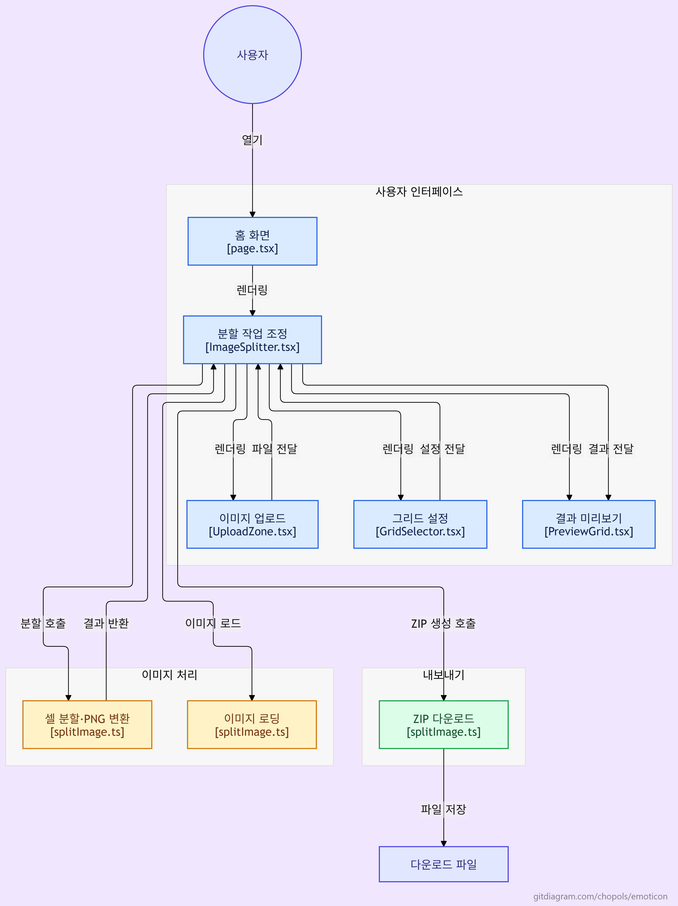

# 이모티콘 스프라이트 자르기 (Emoticon Sprite Splitter)

<div align="center">

[](https://nextjs.org/)
[](https://react.dev/)
[](https://www.typescriptlang.org/)
[](https://tailwindcss.com/)
[](#)

**15개의 캐릭터가 포함된 스프라이트 시트를 손쉽게 15칸 그리드로 분할하고, 360×360 PNG 파일로 변환하여 ZIP으로 일괄 다운로드하는 웹 도구입니다.**

[🌐 데모 사이트 바로가기](http://ubuntu.ibzsoft.com/emoticon/)

</div>

---

## 📌 목차
1. [프로젝트 소개](#-프로젝트-소개)
2. [주요 기능](#-주요-기능)
3. [아키텍처 및 시스템 다이어그램](#-아키텍처-및-시스템-다이어그램)
4. [기술 스택](#-기술-스택)
5. [프로젝트 구조](#-프로젝트-구조)
6. [시작하기](#-시작하기)
7. [빌드 및 배포](#-빌드-및-배포)
8. [보안 및 성능 최적화](#-보안-및-성능-최적화)

---

## 📖 프로젝트 소개

메신저 및 플랫폼(카카오톡, 라인 등)용 이모티콘을 제작할 때, 디자이너는 여러 프레임이나 캐릭터를 하나의 스프라이트 시트(대지)에 배치하여 작업하는 경우가 많습니다.

**이모티콘 스프라이트 자르기**는 시트 이미지 하나만 업로드하면 자동으로 각 셀을 감지·분할하여 플랫폼 규격(360×360 px)에 맞춘 개별 이미지로 가공하고 ZIP 파일로 묶어 다운로드할 수 있게 돕는 실용적인 생산성 도구입니다.

> 🔒 **100% 클라이언트 사이드 처리**  
> 모든 이미지 프로세싱은 사용자의 웹 브라우저 메모리(HTML5 Canvas API) 내에서만 수행됩니다. 이미지가 외부 서버로 전송되지 않으므로 저작권 및 개인 작업물이 안전하게 보호됩니다.

---

## ✨ 주요 기능

- **간편한 이미지 업로드**
  - 드래그 앤 드롭(Drag & Drop) 및 파일 탐색기 선택 지원
  - PNG / JPG 포맷 유효성 자동 검증
- **유연한 그리드 & 분할 순서 설정**
  - **그리드 레이아웃**: `5 × 3` (가로 5칸, 세로 3칸) 또는 `3 × 5` (가로 3칸, 세로 5칸)
  - **셀 순서(Order)**:
    - **가로줄 순서 (Row-major)**: 좌 → 우, 위 → 아래 (기본값)
    - **세로줄 순서 (Column-major)**: 위 → 아래, 좌 → 우
- **고품질 360×360 규격 자동 변환**
  - 셀 비율을 고려한 중앙 정렬(Letterboxing) 처리
  - 고품질 바이큐빅 리샘플링 (`imageSmoothingQuality = "high"`) 적용
- **실시간 결과 미리보기**
  - 분할된 15개 캐릭터를 원래 그리드 형태와 번호 라벨(1~15)로 즉시 확인
- **원클릭 ZIP 다운로드**
  - 원본 파일명 기준 (`[파일명].zip`)으로 자동 압축
  - 각 셀은 `character_01.png` ~ `character_15.png` 규칙으로 저장
- **메모리 누수 방지**
  - 이미지 교체 또는 재설정 시 기존 `ImageBitmap.close()` 및 `URL.revokeObjectURL()` 호출을 통한 브라우저 메모리 자동 해제

---

## 📐 아키텍처 및 시스템 다이어그램

<div align="center">
  <a href="https://gitdiagram.com/chopols/emoticon">
    
  </a>
</div>

---

## 🛠 기술 스택

| 구분 | 기술 / 라이브러리 | 버전 | 용도 |
| :--- | :--- | :--- | :--- |
| **Framework** | [Next.js](https://nextjs.org/) (App Router) | `16.3.3` | 정적 웹 애플리케이션 프레임워크 (`output: 'export'`) |
| **UI Library** | [React](https://react.dev/) | `19.2.8` | 컴포넌트 기반 UI 렌더링 |
| **Language** | [TypeScript](https://www.typescriptlang.org/) | `^5` | 정적 타입 검증 및 DX 향상 |
| **Styling** | [Tailwind CSS](https://tailwindcss.com/) | `^4` | 유틸리티 퍼스트 CSS 스타일링 |
| **Compression** | [JSZip](https://stuk.github.io/jszip/) | `^3.10.1` | 브라우저 내 파일 ZIP 압축 |
| **File Handling** | [file-saver](https://github.com/eligrey/FileSaver.js) | `^2.0.5` | 클라이언트 사이드 파일 다운로드 트리거 |
| **Deployment** | PowerShell + SSH/SCP | - | 원격 서버 무중단 정적 배포 자동화 |

---

## 📁 프로젝트 구조

```text
emoticon/
├── app/
│   ├── globals.css          # Tailwind CSS 전역 스타일
│   ├── layout.tsx           # 루트 레이아웃 및 메타데이터 정의
│   └── page.tsx             # 메인 뷰 렌더링
├── components/
│   ├── ImageSplitter.tsx    # 전체 워크플로우 상태 관리 및 메인 컨트롤러
│   ├── UploadZone.tsx       # 파일 드래그앤드롭 및 업로드 인터페이스
│   ├── GridSelector.tsx     # 그리드 규격(5×3, 3×5) 및 읽기 순서 선택기
│   └── PreviewGrid.tsx      # 분할 완료된 15개 셀 미리보기 컴포넌트
├── lib/
│   └── splitImage.ts        # Canvas 이미지 분할, 비트맵 로더, ZIP 생성 유틸
├── public/                  # 정적 애셋 디렉터리
├── deploy.ps1               # 서버 배포용 PowerShell 스크립트
├── diagram.png              # 프로젝트 아키텍처 다이어그램
├── next.config.ts           # Next.js 설정 (정적 내보내기 및 basePath 지정)
├── package.json             # 프로젝트 의존성 및 스크립트
└── tsconfig.json            # TypeScript 컴파일러 설정
```

---

## 🚀 시작하기

### 1. 사전 요구사항
- Node.js `20.x` 이상
- npm, pnpm 또는 yarn

### 2. 설치

```bash
# 레포지토리 클론
git clone https://github.com/chopols/emoticon.git
cd emoticon

# 의존성 패키지 설치
npm install
```

### 3. 개발 서버 실행

```bash
npm run dev
```

브라우저에서 [http://localhost:3000/emoticon/](http://localhost:3000/emoticon/)으로 접속합니다.  
*(※ `next.config.ts`의 `basePath: "/emoticon"` 설정에 따라 하위 경로로 라우팅됩니다.)*

### 4. 린트 검사

```bash
npm run lint
```

---

## 📦 빌드 및 배포

### 정적 사이트 빌드 (SSG)
이 프로젝트는 서버리스/정적 호스팅 환경에 최적화되어 있으며, 빌드 시 정적 HTML/CSS/JS 파일이 `out/` 디렉터리에 생성됩니다.

```bash
npm run build
```

### 원격 서버 배포 (`deploy.ps1`)
PowerShell 스크립트를 통해 원격 리눅스 서버(`ubuntu.ibzsoft.com`)로 자동 빌드 및 배포할 수 있습니다.

```powershell
# 빌드 후 원격 서버로 배포
./deploy.ps1

# 빌드를 생략하고 기존 out/ 디렉터리만 배포할 경우
./deploy.ps1 -NoBuild

# 옵션 파라미터 예시
./deploy.ps1 -Server "chopols@ubuntu.ibzsoft.com" -Key "$HOME\.ssh\emoticon_server" -RemoteDir "/home/chopols/html/emoticon"
```

배포 후 확인 주소: **[http://nginx.ibzsoft.com/emoticon/](http://nginx.ibzsoft.com/emoticon/)**

---

## 💡 구현 상세 & 최적화 포인트

1. **캔버스 기반 고화질 분할 알고리즘 (`lib/splitImage.ts`)**
   - 대용량 이미지 처리 시 메인 스레드 렌더링 블로킹을 방지하기 위해 `createImageBitmap`을 우선적으로 사용하고 구형 브라우저에서는 `Image` 객체로 폴백합니다.
   - 원본 셀의 가로세로 비율이 1:1이 아닐 경우에도 이미지가 왜곡되지 않도록 종횡비를 계산하여 360×360 px 중앙에 배치(Letterboxing)합니다.

2. **메모리 생명주기 관리**
   - 대용량 이미지와 분할된 Blob 객체들로 인한 브라우저 메모리 릭(Leak)을 방지하기 위해 새 이미지 업로드 또는 설정 변경 시 직전 비트맵(`bitmap.close()`)과 생성된 Object URL(`URL.revokeObjectURL()`)을 철저히 해제합니다.

3. **반응형 & 어스톤(Earth-tone) 디자인**
   - 크림톤 배경(`#FAF5EC`)과 카드 형태의 레이아웃, 직관적인 호버 트랜지션을 적용하여 사용자에게 편안하고 세련된 인터페이스를 제공합니다.
